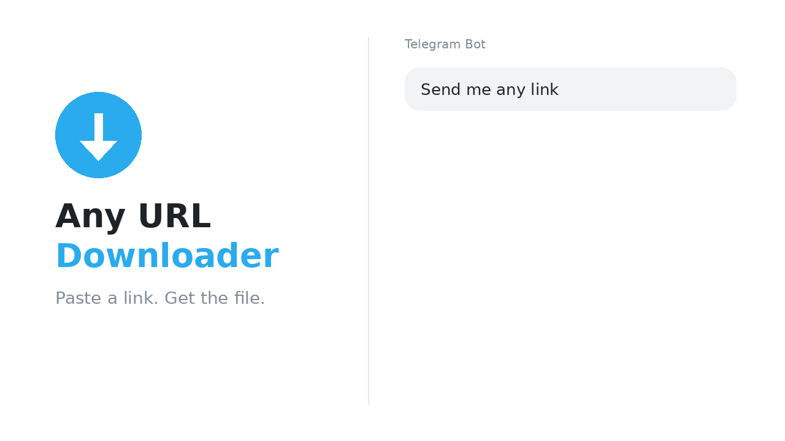

<p align="center">
  
</p>

<h1 align="center">⚡ ANY URL, HLS (.m3u8), ZOOM & GOOGLE DRIVE DOWNLOADER BOT</h1>

<p align="center">
  <b>Production-Grade Asynchronous Telegram Bot with 4GB Hybrid Upload Architecture, 8-Connection Parallel Range Engine, 16-Fragment HLS/DASH Concurrency, Interactive Inline UI, In-Chat Zoom Passcode Prompts, and One-Command Systemd Deployment.</b>
</p>

<p align="center">
  <a href="https://github.com/NimeshPiyathissa/ANY-URL-DOWNLOADER/releases/tag/v2.0.0"></a>
  <a href="https://www.python.org/"></a>
  <a href="https://github.com/Mayuri-Chan/pyrofork"></a>
  <a href="https://github.com/yt-dlp/yt-dlp"></a>
  <a href="https://github.com/wkentaro/gdown"></a>
  <a href="#-4gb-hybrid-upload-architecture"></a>
  <a href="LICENSE"></a>
</p>

---

## 📑 Table of Contents

- [What's New in v2.0.0](#-whats-new-in-v200)
- [Architecture & Upload Modes](#-architecture--upload-modes)
- [Key Features](#-key-features)
- [Interactive UI & User Experience](#-interactive-ui--user-experience)
- [Command & Input Syntax Reference](#-command--input-syntax-reference)
- [Project Structure](#-project-structure)
- [One-Command Quick Deployment](#-one-command-quick-deployment-recommended)
- [Step-by-Step Ubuntu VPS Setup](#-step-by-step-ubuntu-vps-setup)
- [Troubleshooting & FAQ](#-troubleshooting--faq)
- [License & Contributions](#-license--contributions)

---

## 🚀 What's New in v2.0.0

* **⚡ 8-Connection Multi-Range Direct Downloader:** Parallel chunk downloading utilizing up to 8 simultaneous byte-range connections and 1MB buffers for maximum VPS bandwidth saturation.
* **📡 16-Fragment HLS/DASH Concurrency:** Native Python segment downloading (`hls_prefer_native: True`) with 16 concurrent fragments and 10MB chunk buffers, completely eliminating `ffmpeg code 255` errors.
* **📁 Native Google Drive Engine:** Direct integration with `gdown` supporting public files, shared folders, confirmation token bypass, and live progress reporting.
* **🔐 Interactive Zoom Passcode Prompt:** Send a protected Zoom recording link without a password, and the bot will ask for the passcode directly in chat with an interactive `❌ Cancel` button (2-minute auto-timeout).
* **📝 Interactive Post-Download Caption Prompt:** Send a custom Telegram caption within 30 seconds of download completion, or tap `⏭️ Use Default Filename` to proceed immediately.
* **📊 Fragment-Aware Live Progress Bars:** Displays clean visual progress gauges (`[██████░░░░] 60.0%`), real-time speed (`MB/s`), downloaded size vs total size, ETA countdown, and fragment index (`12 / 20`).
* **🛠️ One-Command Systemd Installer (`setup_service.sh`):** Automates user detection, environment verification, systemd unit generation, enabling, and service start in a single command.

---

## ⚡ Architecture & Upload Modes

Standard Telegram Bot API accounts are strictly limited to uploading files $\le$ **2.0 GB**. This project solves that limitation with an intelligent **dual-client hybrid architecture**:

```
                                  ┌────────────────────────┐
                                  │   Incoming URL Task    │
                                  └───────────┬────────────┘
                                              │
                         [Download via 8x HTTP / 16x HLS / gdown]
                                              │
                             [Interactive Caption Prompt (30s)]
                                              │
                      ┌───────────────────────┴───────────────────────┐
                      │                                               │
             File Size <= 2.0 GB                             File Size > 2.0 GB
                      │                                               │
           [Standard Bot Client]                           [Secondary User Client]
                      │                                      (Telegram Premium)
                      │                                               │
        Uploads Directly to Chat                       Uploads to Private Relay Channel
                      │                                               │
                      │                                    [Bot Client Copies Message]
                      │                                               │
                      └───────────────────────┬───────────────────────┘
                                              │
                                     Clean Delivery to User
```

| Capability | Standard Bot Mode | Hybrid Premium Relay Mode |
| :--- | :--- | :--- |
| **Max File Size Limit** | `2.0 GiB` | `4.0 GiB` |
| **Required Telegram Accounts** | 1 Bot Token (via [@BotFather](https://t.me/BotFather)) | 1 Bot Token + 1 Premium User Session |
| **Setup Complexity** | Zero configuration (default) | Paste `USER_SESSION_STRING` & `DUMP_CHAT_ID` |
| **Direct HTTP Engine** | 8-Connection Parallel Range | 8-Connection Parallel Range |
| **HLS / DASH Streams** | 16-Fragment Concurrency | 16-Fragment Concurrency |
| **Google Drive Engine** | Yes (`gdown` integration) | Yes (`gdown` integration) |
| **Zoom Cloud Recordings** | Interactive Passcode & Cookies | Interactive Passcode & Cookies |

---

## 🌟 Key Features

* **📥 Multi-Connection Direct HTTP Engine:**
  * Probes server capabilities using `Range: bytes=0-0` requests.
  * Splits files larger than 4MB across 8 parallel worker connections downloading byte slices simultaneously.
  * Concatenates parts in-memory/stream without corrupting multi-gigabyte archives or video files.

* **📡 16-Fragment Concurrent HLS & DASH Ingestion (`.m3u8` / `.mpd`):**
  * Auto-detects manifest URLs, bypassing complex query tokens.
  * Native Python downloader streams 16 fragments simultaneously.
  * **Intelligent Unicode/Sinhala Directory Extraction:** Automatically URL-decodes parent folder names for generic `/master.m3u8` or `/index.m3u8` links (e.g., `%E0%B6%B4%E0%B7%8F%E0%B6%A9%E0%B6%B8` $\rightarrow$ `පාඩම.mp4`).

* **📁 High-Speed Google Drive Downloader:**
  * Handles standard `drive.google.com/file/d/...`, `open?id=...`, `uc?id=...`, and shared folder links.
  * Automatically bypasses Google Drive's viral download confirmation screens for large files.

* **🔐 Interactive In-Chat Zoom Passcode Prompt:**
  * Sends a probe to the recording URL. If locked, prompts the user:
    `"🔐 This Zoom recording requires a Passcode. Please reply with the Zoom Passcode now:"`
  * Captures the reply with an in-memory `asyncio.Future` and resumes the download automatically.
  * Supports Netscape-formatted `cookies.txt` for passwordless organizational SSO meetings.

* **📝 Interactive Custom Caption Prompt:**
  * Once downloaded, users have 30 seconds to send any custom text message with Markdown formatting to use as the Telegram media caption.
  * Includes `⏭️ Use Default Filename` and `❌ Cancel Upload` inline action buttons.
  * Automatically defaults to the clean file title if no reply is received within 30 seconds.

* **🎬 FFmpeg Video Metadata & Streaming Optimization:**
  * Runs `ffprobe` asynchronously to extract duration, dimensions, and smartphone 90°/270° orientation tags.
  * Generates high-definition Telegram thumbnails (max width 320px).
  * Sets `supports_streaming=True` for immediate in-app video playback.

---

## 📱 Interactive UI & User Experience

<table align="center">
  <tr>
    <td align="center"><b>Interactive Main Menu</b></td>
    <td align="center"><b>Live Progress Reporting</b></td>
  </tr>
  <tr>
    <td>
      <pre>
👋 Hello Alex!
Welcome to Any URL Downloader v2.0.0

[📥 Supported Links]  [🔐 Private Zoom]
[📁 Google Drive   ]  [⚙️ Caption & Naming]
[       📊 Server Status        ]
      </pre>
    </td>
    <td>
      <pre>
📥 Downloading File...
[██████░░░░] 60.0%

⚡ Speed: 14.50 MB/s
💾 Processed: 300.00 MB / 500.00 MB
⏳ ETA: 00:13
🧩 Fragments: 12 / 20
📁 File: Lecture_01.mp4
      </pre>
    </td>
  </tr>
</table>

---

## 💡 Command & Input Syntax Reference

### Telegram Bot Commands

| Command | Description |
| :--- | :--- |
| `/start` | Open the interactive main menu with navigation buttons and system status. |
| `/help` | Detailed guide with copy-ready examples for all supported links. |
| `/status` | Real-time server health: concurrency, upload mode (2GB vs 4GB), and engine metrics. |

### Download Input Formats

| Media Type | Syntax Pattern | Example Input |
| :--- | :--- | :--- |
| **Direct URL** (Auto Name) | `URL` | `https://releases.ubuntu.com/24.04/ubuntu-24.04-desktop-amd64.iso` |
| **Direct URL** (Custom Name) | `URL \| custom_name.ext` | `https://example.com/files/archive.zip \| Backup_May.zip` |
| **HLS Stream** (Auto Name) | `URL` | `https://cdn.site.com/%E0%B6%B4%E0%B7%8F%E0%B6%A9%E0%B6%B8/master.m3u8` |
| **HLS / DASH Stream** (Custom Name) | `URL \| custom_name.mp4` | `https://cdn.site.com/hls/index.m3u8 \| Physics_Rev.mp4` |
| **Google Drive File** | `URL` | `https://drive.google.com/file/d/1A2B3C4D5E6F/view` |
| **Google Drive** (Custom Name) | `URL \| custom_name.ext` | `https://drive.google.com/file/d/1A2B3C4D5E6F/view \| Book.pdf` |
| **Zoom Recording** (Interactive) | `Zoom_URL` | `https://us02web.zoom.us/rec/share/abc123xyz` *(Prompts in chat)* |
| **Zoom Recording** (Inline Passcode) | `Zoom_URL \| passcode` | `https://us02web.zoom.us/rec/share/abc123xyz \| Pass@123` |
| **Zoom Recording** (Pass + Name) | `Zoom_URL \| pass \| name.mp4` | `https://us02web.zoom.us/rec/share/abc123xyz \| Pass@123 \| Class.mp4` |

---

## 📁 Project Structure

```ascii
ANY-URL-DOWNLOADER/
├── assets/
│   └── banner.gif            # Animated GitHub hero banner
├── bot.py                    # Dual-client MTProto bot, interactive buttons & caption prompt
├── downloader.py             # 8x HTTP parallel range, 16x HLS/DASH & Google Drive engines
├── utils.py                  # FFmpeg/ffprobe async wrappers, thumbnails, progress bar
├── config.py                 # Configuration parser & dynamic 2GB/4GB limit resolver
├── test_suite.py             # 17-point regression & component test suite
├── setup_service.sh          # One-command systemd installer & daemon setup
├── requirements.txt          # Production dependencies (Pyrofork, yt-dlp, gdown, etc.)
├── .env.example              # Environment variables template
├── .gitignore                # Git ignore rules for secrets, downloads, and sessions
└── README.md                 # Complete documentation & deployment guide
```

---

## ⚡ One-Command Quick Deployment (Recommended)

On any fresh **Ubuntu 20.04 / 22.04 / 24.04 VPS**:

```bash
# 1. Install Git and clone repository
sudo apt update && sudo apt install -y git
git clone https://github.com/NimeshPiyathissa/ANY-URL-DOWNLOADER.git /opt/any-url-downloader
cd /opt/any-url-downloader

# 2. Configure credentials
cp .env.example .env
nano .env

# 3. Run the one-command installer
sudo bash setup_service.sh
```

The script will automatically detect the user, set up the Python virtual environment, install dependencies, create `/etc/systemd/system/any-url-bot.service`, enable it, and start the bot immediately!

---

## 🛠️ Step-by-Step Ubuntu VPS Setup

<details>
<summary><b>Click to expand manual setup instructions</b></summary>

### 1. Install System Dependencies

```bash
sudo apt update && sudo apt install -y python3 python3-pip python3-venv ffmpeg build-essential python3-dev git
```

### 2. Setup Virtual Environment

```bash
cd /opt/any-url-downloader
python3 -m venv venv
source venv/bin/activate
pip install --upgrade pip
pip install -r requirements.txt
```

### 3. Configure `.env`

```ini
API_ID=12345678
API_HASH=0123456789abcdef0123456789abcdef
BOT_TOKEN=123456789:ABCdefGhIJKlmNoPQRsTUVwxyZ_1234567

# Optional: Unlocks 4GB Uploads with Telegram Premium
USER_SESSION_STRING=
DUMP_CHAT_ID=

# Access Control (Leave blank for public)
AUTHORIZED_USERS=

# Concurrency & Performance
MAX_CONCURRENT_DOWNLOADS=3
PROGRESS_UPDATE_INTERVAL=3.5
DOWNLOAD_DIR=downloads
```

### 4. Run Test Suite

```bash
python test_suite.py
```

### 5. Launch Service

```bash
sudo bash setup_service.sh
```
</details>

---

## 📊 Live Monitoring & Commands

```bash
# View live real-time logs
sudo journalctl -u any-url-bot.service -f

# Restart bot after changing .env
sudo systemctl restart any-url-bot.service

# Check service status
sudo systemctl status any-url-bot.service

# Pull latest updates from GitHub
cd /opt/any-url-downloader
git pull origin main
sudo systemctl restart any-url-bot.service
```

---

## ❓ Troubleshooting & FAQ

<details>
<summary><b>1. How do I enable 4GB uploads?</b></summary>
<br>
Generate a Pyrofork/Pyrogram session string from an account with Telegram Premium. Paste it into <code>USER_SESSION_STRING</code> in your <code>.env</code> file, set <code>DUMP_CHAT_ID</code> to a private channel where both your bot and user account are admins, and run <code>sudo systemctl restart any-url-bot.service</code>.
</details>

<details>
<summary><b>2. Zoom links fail with 403 Forbidden</b></summary>
<br>
Some universities or enterprises require login authentication. Export your browser cookies in Netscape format using an extension like <i>Get cookies.txt LOCALLY</i>, save them as <code>cookies.txt</code> in <code>/opt/any-url-downloader/cookies.txt</code>, and restart the bot.
</details>

<details>
<summary><b>3. Large Google Drive files show quota exceeded</b></summary>
<br>
Google limits high-traffic public files. If a file cannot be downloaded publicly, copy it to your personal Google Drive or download directly using the shared link.
</details>

---

## 📄 License & Contributions

Distributed under the **MIT License**. PRs, issues, and feature suggestions are always welcome!

<p align="center">
  <b>Built with ❤️ for ultra-fast, unrestricted downloading on Telegram.</b>
</p>
